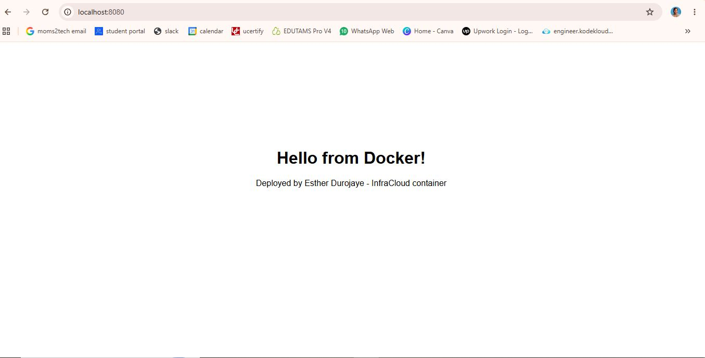
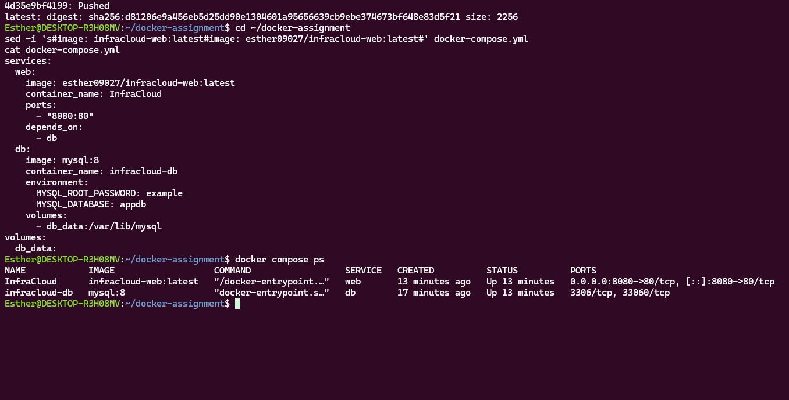
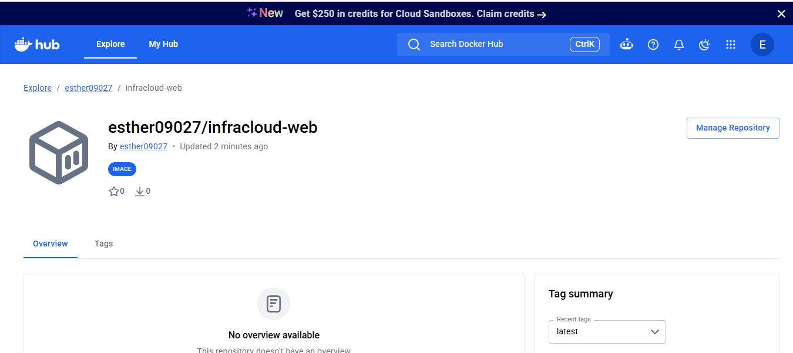

# Docker Assignment: Containerized Web App with Compose

A static web page served by Nginx in a custom Docker image, deployed alongside a MySQL database using Docker Compose.

## Docker Hub


- Profile: https://hub.docker.com/u/esther09027
- Image repo: https://hub.docker.com/r/esther09027/infracloud-web

## Files

| File | Purpose |
|---|---|
| `Dockerfile` | Builds the custom image from `nginx:alpine` and copies in `index.html` |
| `docker-compose.yml` | Runs the web container and a MySQL 8 database container |
| `index.html` | The static web page |

## Run the image from Docker Hub

```bash
docker pull esther09027/infracloud-web:latest
docker run -d -p 8080:80 --name InfraCloud esther09027/infracloud-web:latest
```

Open http://localhost:8080

## Run with Docker Compose (web + database)

```bash
docker compose up -d
docker compose ps
```

Open http://localhost:8080. Stop everything with `docker compose down`.

## Build the image locally

```bash
docker build -t infracloud-web:latest .
```

## Screenshots

### App running in the container


### Docker Compose: web and database running


### Image pushed to Docker Hub


## Author

Esther Durojaye
